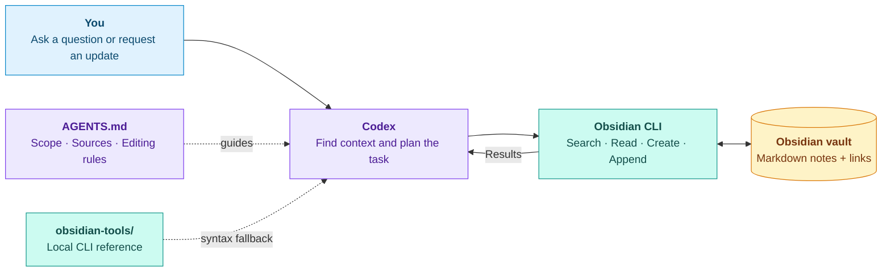

## Prompt to Knowledge · AI Study Vault

### Algorithms Notes You Can Talk to

Search your notes, connect ideas, and build on what you learn, all from a prompt.

This project combines **Codex**, the **Obsidian CLI**, and a linked **Markdown knowledge base** into a reusable study workflow. **UW–Madison's CS577 (Introduction to Algorithms) lectures are the worked example**: explain why Dijkstra fails on negative edges, practice a dynamic-programming table, or add a new example to an existing note without starting from scratch.

This design can be applied into managing documentation of any kind. You can use this for maintaining your family's health records, cooking recipes, and so much more.

## Inspiration

I found myself frequently forgetting a lot of the processes and protocols I learned at work, repeatedly having to ask my coworkers simple questions about tasks I've already completed before. For me, this project is aimed at increasing my own efficiency by keeping a robust, AI powered documentation engine.

**[Get started](setup/local-setup.md)** · **[Explore a topic](dijkstra-shortest-paths.md)** · **[Try the practice set](exam-prep/practice/algorithms-practice.md)**

<table>
  <tr>
    <td align="center"><strong>44</strong><br>Concept notes</td>
    <td align="center"><strong>18</strong><br>Practice questions</td>
    <td align="center"><strong>6</strong><br>Study guides</td>
    <td align="center"><strong>3</strong><br>Agent instruction files</td>
  </tr>
</table>

---

## From Scattered Material to Connected Knowledge

Lecture slides, worked examples, and practice problems all contain useful information, but finding the right explanation takes time. Adding new material can also create duplicate notes, or lose track of the source behind an answer.

This vault gives the agent a clear process: **find the existing note, read the context, and make only the requested change**. Related ideas stay linked. Dijkstra lives with the greedy algorithms but links to Bellman–Ford in dynamic programming, and to union–find in the primer. Source references stay attached to the knowledge they support.

## How it Works



The agent runs commands through local terminal access. Obsidian supplies the CLI, and the repository supplies the notes and the instructions. When the agent is unsure of a command's syntax, it checks the installed `obsidian help` first, then falls back to the copy of the official CLI documentation in `obsidian-tools/`. Every change is plain Markdown that you can review with Git.

## Three Ways to Use it

| Ask | Practice | Build |
| :--- | :--- | :--- |
| Find an explanation across related notes. | Work through one question at a time. | Add new material to an existing topic. |
| "Why does Dijkstra fail with negative edges, and what replaces it?" | "Quiz me on knapsack tables. Wait for my answer." | "Add this Kruskal example to the MST note and preserve its sources." |
| Read the answer in chat. | Get hints and feedback on your reasoning. | Review the changed file and its links. |

### A Small Demo to Try

**1 · Read without editing**

> Using only this vault, compare Dijkstra and Bellman–Ford. Link the relevant notes. Do not edit files.

**2 · Add something useful**

> Read the root and concepts instructions. Add a short, original Prim's-algorithm trace to the existing MST note. Avoid repeating what is already there, and preserve the sources.

**3 · Check the result**

Open the note in Obsidian, follow its links, and review the diff in Git. You can see exactly what the agent changed.

## What is inside

| Area | Topics |
| :--- | :--- |
| **Primer** | Efficiency and the word RAM, asymptotic notation, amortized analysis, union–find, heaps, graph traversal, SCCs, topological order |
| **Divide and conquer** | Merge sort, recurrences and the Master theorem, lower bounds, binary search on the answer, inversions, Karatsuba and Strassen, closest pair, selection, randomized quicksort |
| **Greedy** | Proof techniques (stays ahead, exchange), interval scheduling, lateness, caching, Huffman coding, Dijkstra, minimum spanning trees |
| **Dynamic programming** | The DP method, weighted intervals, LIS, knapsack, edit distance and alignment, game DP, segmented least squares, RNA folding, Bellman–Ford, all-pairs shortest paths |
| **Network flow** | Ford–Fulkerson, max-flow min-cut, matching and disjoint paths, min-cut applications, circulations with demands and lower bounds |
| **NP-completeness** | Polynomial-time reductions, P, NP, and NP-completeness, Cook–Levin, classic reductions |
| **Exam preparation** | Six study guides and 18 original practice questions, with separate derived solutions |

<details>
<summary><strong>View the folder structure</strong></summary>

```text
prompt-to-knowledge/
├── AGENTS.md               # Rules for the whole vault
├── README.md
├── setup/                  # Local setup and source details
├── obsidian-tools/
│   └── obsidian-cli.md     # Local CLI reference the agent falls back on
├── concepts/
│   ├── AGENTS.md           # How to explain and maintain concepts
│   ├── primer/
│   ├── divide-and-conquer/
│   ├── greedy/
│   ├── dynamic-programming/
│   ├── network-flow/
│   └── np-completeness/
├── exam-prep/
│   ├── AGENTS.md           # How to quiz, give hints, and grade
│   ├── study-guides/
│   └── practice/
└── _inbox/                 # New material awaiting requested ingestion
```

</details>

## The Instructions Are Part of the Design

The three `AGENTS.md` files give the agent different responsibilities:

| File | Responsibility |
| :--- | :--- |
| [Vault-wide instructions](AGENTS.md) | Define task scope, note format, source handling, and when edits are allowed. |
| [Concepts instructions](concepts/AGENTS.md) | Explain mechanisms, state the model and proof technique, and update the existing concept note. |
| [Exam-prep instructions](exam-prep/AGENTS.md) | Support quizzes, hints, worked solutions, and grading with observable intermediate state. |

Questions are read-only by default. Documentation changes require a request. Incoming material is processed only when it is selected, and deleting a file requires explicit approval.

These files guide the agent's behavior; access permissions come from the execution environment. The root file is global **within this project**, so it does not need to replace your personal agent configuration.

## Get it Running

1. **Open the folder in Obsidian** as a separate vault.
2. **Enable the Obsidian CLI** in Settings → General and complete registration. Keep Obsidian running.
3. **Open the same folder in Codex** with local terminal access.
4. **Confirm the connection**, then try one of the prompts above:

```sh
obsidian vault="prompt-to-knowledge" vault info=name
obsidian vault="prompt-to-knowledge" search query="path:concepts Dijkstra"
```

Use the name you gave your local vault. The [setup guide](setup/local-setup.md) covers requirements, command examples, and optional Git setup.

## Engineering Choices

- **Plain Markdown:** notes are easy to inspect, edit, and version.
- **Obsidian-aware commands:** the agent searches and edits through the same application that manages the knowledge base.
- **A local tool reference:** a copy of the CLI documentation ships with the vault, so the agent can look up syntax without browsing. The installed `obsidian help` still wins if the two disagree, and risky commands such as publish, sync, plugin installs, and permanent deletes stay off-limits without explicit approval.
- **Search before creation:** an existing explanation is extended whenever a topic already has a home.
- **Organized by technique, not by lecture:** a question about "greedy" or "DP" lands in one folder, and cross-links connect the graph algorithms that span folders.
- **Source references:** every note points back to the original PDF pages, and unresolved slide discrepancies are recorded instead of silently fixed.
- **Scoped instructions:** concept notes and exam practice follow different workflows.
- **Visible changes:** you review the actual files and diffs after every update.

The project demonstrates AI workflow design, command-line integration, technical writing, and knowledge organization through a concrete study use case.

<details>
<summary><strong>Sources, scope, and reuse</strong></summary>

The notes synthesize 15 supplied CS577 lecture decks. They are study documentation, not slide transcriptions, an official answer key, or a complete syllabus. Original examples and derived solutions are labeled, and unclear source details are not filled in by guessing. See [source materials](setup/source-materials.md) for filenames, page counts, and the unresolved items.

The original PDFs are not bundled. Check redistribution permission before publishing course files or substantial copied course content. This vault does not assign a license to the course authors' work.

Keep a separate personal vault private. Local file storage does not mean offline inference: text the agent reads can be sent to its model provider.

To adapt the vault to another subject, replace the study content and adjust the folder instructions to match your workflow.

</details>
