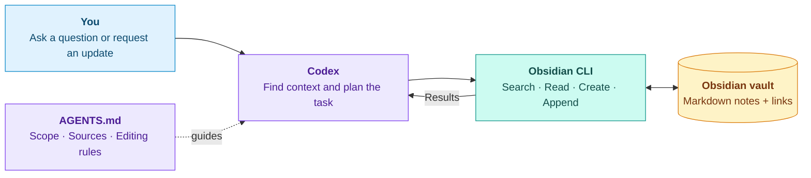

# Prompt to Knowledge · AI Study Vault

### Operating systems notes you can talk to

Search your notes, connect ideas, and build on what you learn with a prompt.

This project brings **Codex**, **Obsidian CLI**, and a linked **Markdown knowledge base** together in a reusable study workflow. **UW Madison's CS537 operating systems material provides a working example**: explain a memory concept, practice a concurrency problem, or add new notes without starting from scratch.

**[Get started](setup/local-setup.md)** · **[Explore a topic](review/virtualization/cpu-scheduling.md)** · **[Try the practice set](exam-prep/practice/operating-systems-practice.md)**

<table>
  <tr>
    <td align="center"><strong>26</strong><br>Concept notes</td>
    <td align="center"><strong>16</strong><br>Practice questions</td>
    <td align="center"><strong>4</strong><br>Past-exam guides</td>
    <td align="center"><strong>3</strong><br>Agent instruction files</td>
  </tr>
</table>

---

## From scattered material to connected knowledge

Course notes, review sheets, and old exams contain useful information, but finding the right explanation takes time. Adding new material can also create duplicate notes or lose the source behind an answer.

This vault gives the agent a clear process: **find the existing note, read the context, and make the requested change**. Related ideas stay linked, and source references stay attached to the knowledge they support.

## How it works



The agent runs commands through local terminal access. Obsidian supplies the CLI; the repository supplies the notes and instructions. The resulting Markdown changes can be reviewed with Git.

## Three ways to use it

| Ask | Practice | Build |
| :--- | :--- | :--- |
| Find an explanation across related notes. | Work through one question at a time. | Add new material to an existing topic. |
| “How is a TLB miss different from a page fault?” | “Quiz me on condition variables. Wait for my answer.” | “Add this example to the scheduling note and preserve its sources.” |
| Read the answer in chat. | Get hints and feedback on your reasoning. | Review the changed file and its links. |

### A small demo to try

**1 · Read without editing**

> Using only this vault, explain the difference between a TLB miss and a page fault. Link the relevant notes. Do not edit files.

**2 · Add something useful**

> Read the root and review instructions. Add a short, original TLB-hit example to the existing TLB note. Avoid repeating what is already there and preserve the sources.

**3 · Check the result**

Open the note in Obsidian, follow its links, and review the diff in Git. You can see exactly what the agent changed.

## What is inside

| Area | Topics |
| :--- | :--- |
| **Virtualization** | Processes, CPU scheduling, address translation, TLBs, page replacement, and working sets |
| **Concurrency** | Threads, races, locks, condition variables, semaphores, and deadlocks |
| **Persistence** | Devices, disks, RAID, file systems, journaling, LFS, SSDs, and checksums |
| **Advanced topics** | Network reliability, RPC, distributed file systems, VMs, containers, and multiprocessor scheduling |
| **Exam preparation** | Three study guides, four historical exam guides, and original practice with separate solutions |

<details>
<summary><strong>View the folder structure</strong></summary>

```text
cs537-os-starter/
├── AGENTS.md               # Rules for the whole vault
├── README.md
├── setup/                  # Local setup and source details
├── review/
│   ├── AGENTS.md           # How to explain and maintain concepts
│   ├── virtualization/
│   ├── concurrency/
│   ├── persistence/
│   └── advanced/
├── exam-prep/
│   ├── AGENTS.md           # How to quiz, give hints, and grade
│   ├── study-guides/
│   ├── practice/
│   └── past-exams/
│       ├── fa15/
│       ├── fa19/
│       ├── fa23/
│       └── fa24/
└── _inbox/                 # New material awaiting requested ingestion
```

</details>

## The instructions are part of the design

The three `AGENTS.md` files give the agent different responsibilities:

| File | Responsibility |
| :--- | :--- |
| [Vault-wide instructions](AGENTS.md) | Define task scope, note format, source handling, and when edits are allowed. |
| [Review instructions](review/AGENTS.md) | Explain mechanisms clearly, state assumptions, and update the existing concept note. |
| [Exam-prep instructions](exam-prep/AGENTS.md) | Support quizzes, hints, worked solutions, and grading while keeping exam years separate. |

Questions are read-only by default. Documentation changes require a request. Incoming material is processed only when selected, and deleting a file requires explicit approval.

These files guide the agent's behavior. Access permissions come from the execution environment. The root file is global **within this project**, so it does not need to replace your personal agent configuration.

## Get it running

1. **Open the folder in Obsidian** as a separate vault.
2. **Enable Obsidian CLI** in Settings → General and complete registration. Keep Obsidian running.
3. **Open the same folder in Codex** with local terminal access.
4. **Confirm the connection**, then try a prompt above.

```sh
obsidian vault="cs537-os-starter" vault info=name
obsidian vault="cs537-os-starter" search query="path:review paging"
```

Use the name you assigned to your local vault. The [setup guide](setup/local-setup.md) covers requirements, command examples, and optional Git setup.

## Engineering choices

- **Plain Markdown:** notes are easy to inspect, edit, and version.
- **Obsidian-aware commands:** search and edit through the same application that manages the knowledge base.
- **Search before creation:** extend the existing explanation when a topic already has a home.
- **Source references:** keep a path back to the original material.
- **Scoped instructions:** use different workflows for concept review and exam practice.
- **Visible changes:** review the actual files and diffs after an update.

The project demonstrates AI workflow design, command-line integration, technical writing, and knowledge organization through a concrete study use case.

<details>
<summary><strong>Sources, scope, and reuse</strong></summary>

The notes synthesize three supplied review collections and four historical exams. They are study documentation, not full PDF transcriptions, an official answer key, or a complete current course syllabus. Original exercises and derived solutions are labeled.

Historical exam rules stay attached to their year. Unprovided project specifications and unclear source details are not filled in by guessing. See [source materials](setup/source-materials.md) for filenames, page counts, and optional local PDF locations.

Original PDFs are not bundled. Check redistribution permission before publishing course files or substantial copied course content. This starter does not assign a license to the course authors' work.

Keep a separate personal vault private. Local file storage does not mean offline inference: text read by the agent can be sent to its model provider.

To adapt the starter to another subject, replace the study content and adjust the folder instructions to match your workflow.

</details>
